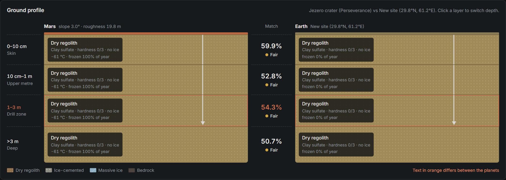
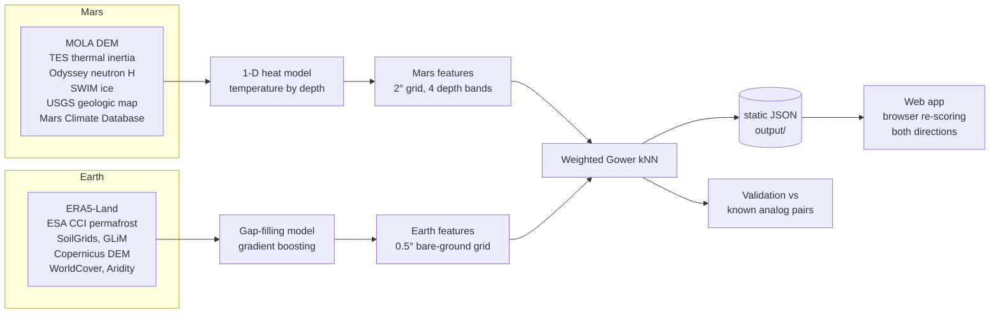

# Planetary Twin 🌎🔴

**Find the place on Earth where the ground behaves like a chosen spot on Mars, and the reverse.**

[](https://dominic-chw.github.io/SpaceApps2026/web/)
[](https://github.com/dominic-chw/SpaceApps2026/actions/workflows/tests.yml)


Rovers and landers drill into Mars, but the hardware has to be tested on Earth first, at sites whose ground conditions resemble the target. Picking those sites today relies largely on experience and a handful of well-known locations. **Planetary Twin** turns that choice into a search problem. Click anywhere on Mars and choose a drilling depth. The app ranks every bare-ground cell on Earth by how closely its temperature, ground ice, ground type, hardness, rock, terrain and dryness match the Mars site, explains each match and links to past drill campaigns. It also proposes *untested* sites that nobody has used yet.

Built for the [NASA Space Apps Challenge 2026](https://www.spaceappschallenge.org/).

---

## Features

| | |
|---|---|
| **Mars → Earth** | Click the 3D Mars globe (or a landing site such as Jezero, Gale or Phoenix), pick one of four depth bands and get the top Earth analogs with match %, confidence, "matched on / differs on", satellite views of both planets and known drill campaigns. |
| **Earth → Mars** | The reverse search: pick any place on Earth to see where it "exists" on Mars. All 12,600 Mars cells are scored in the browser, painted as a heat map on the globe, and the top five are named (e.g. *Near Amazonis Planitia*). |
| **Surface-geology mode** | Reverse search can match **above-ground geology only** (rock type, exposed bedrock vs regolith, slope, roughness, dryness, surface temperature), or a specific depth underground. |
| **City and region search** | Type any city or region (OpenStreetMap geocoding with autocomplete). The app snaps to the nearest drill-testable open ground, shows how far away it is and lists nearby alternatives. |
| **Ground profile** | Side-by-side cross-section of Mars vs the Earth site through all four depth bands, with per-depth match %. |
| **Drill-difficulty heat map** | Globe overlay of how hard each Mars cell is to drill at the selected depth, plus overlays for ground ice, sedimentary or volcanic units and "easy digging". |
| **Mission brief** | One click produces a printable / PDF field-test brief: recommended site, both ground columns, all candidates, past campaigns and the model's validation accuracy. |
| **Tunable weights** | Sliders re-rank the Earth sites live in the browser, using the same maths as the Python pipeline. |
| **Shareable links** | Every view is in the URL (`#lat=18.4&lon=77.5&band=drill_zone`, `#mode=reverse&elat=64.15&elon=-21.94`). |

<p align="center">
  
</p>

<p align="center">
  
  
</p>

## How it works



1. **Same features on both planets.** For each depth band (`0–10 cm`, `10 cm–1 m`, `1–3 m`, `>3 m`): mean temperature, frozen share of the year, temperature swing, ground ice, ground type, hardness (0–3), rock class, slope, roughness and dryness.
2. **Physics where data is missing.** A 1-D heat-conduction model propagates daily and yearly surface temperature waves into the ground (skin depth `δ = √(κP/π)`, from thermal inertia). Mars is 60–100 K colder, so temperatures are compared as within-planet percentiles.
3. **ML where there is data.** A gradient-boosted model fills gaps in Earth ground ice and ground type, using spatial block cross-validation (whole regions held out).
4. **Matching.** Weighted **Gower distance** handles mixed numeric and categorical features and skips missing values. Match % = `100·exp(−d / steepness)`, twins are kept ≥ 200 km apart, and each result lists the features that agreed and disagreed most.
5. **Same maths in the browser.** `web/rescore.js` re-implements the pipeline formula. The weight sliders, the ground profile and the whole Earth → Mars search run client-side, and the two directions give identical numbers for the same pair.

## Does it work?

The scoring was checked against **12 Mars–Earth analog pairs from the literature** (Phoenix ↔ Antarctic Dry Valleys, Jezero ↔ Lake Salda, Gale ↔ Hanksville, …), ranking every one of the **526 Earth places**:

| | Planetary Twin | Random |
|---|---|---|
| Known analog ranked #1 | **17%** | 0.2% |
| In the top 20 | **42%** | 3.9% |
| Mean rank (of 526) | **173** | 251 |

The tool does far better than chance, but it is a research prototype. 12 pairs is a small test set, and some Mars layers (dryness, frozen share) are close to constant. See [`output/validation.json`](output/validation.json) for per-band numbers and the feature ablation.

## Run it

**Easiest:** open the [live demo](https://dominic-chw.github.io/SpaceApps2026/web/).

**Locally:** everything the app needs is committed in `output/`, so there is nothing to download and no API key to set.

```bash
git clone https://github.com/dominic-chw/SpaceApps2026.git
cd SpaceApps2026
python -m http.server 8000        # Windows: py -m http.server 8000
```

Then open <http://localhost:8000/web/>. An internet connection is needed for the map tiles, the Leaflet library and city search.

### Will the data work for everyone?

- **Web app: yes.** The ~55 MB of results in `output/` (one JSON per depth band plus the Earth library) are in the repo, so the app works out of the box for anyone, locally or on GitHub Pages.
- **Re-running the science pipeline: needs the raw data.** `data/` (~7 GB of Mars and Earth rasters) is not in git. `pipeline/data_fetch/` downloads the Mars layers. The Earth layers come from Google Earth Engine (free account) and NASA Earthdata (free login). Put credentials in `.env` (see `.env.example`), then:

```bash
conda env create -f environment.yml && conda activate analog-finder
python -m pipeline.run_all --build      # rebuild features, match, validate -> output/
pytest tests/                           # 64 tests, run on synthetic data (no download needed)
```

## Repository layout

```
web/                  static app: index.html, app.js, rescore.js (scoring in JS), mars-globe.js
output/               pipeline results the app reads (grid/<band>.json, earth_library.json, validation.json)
pipeline/
  data_fetch/         download + build Mars layers (MOLA, TES, neutron, MCD, geologic map)
  earth_library/      global Earth grid from Earth Engine exports, analog regions
  earth_ml/           gradient-boosted gap-filling for Earth ice / ground type
  physics/            1-D subsurface heat model
  mars_features/      per-band Mars feature extraction on a 2° grid
  matching/           normalisation, weighted Gower kNN, explanations
  validation/         known analog pairs, recall@K vs random baseline, ablation
tests/                pytest suite (contract, coordinates, matching, validation, sources)
docs/plan.md          design doc and data contract
```

## Data sources

**Mars:** MGS MOLA 463 m DEM · MGS TES thermal inertia · Mars Odyssey GRS/neutron hydrogen · SWIM subsurface ice maps · USGS Geologic Map of Mars (SIM 3292) · Mars Climate Database v6.1 · CTX and Viking mosaics (imagery).
**Earth:** ERA5-Land · MODIS LST and land cover · ESA CCI Permafrost · Global Permafrost Zonation Index · Pelletier soil/regolith thickness · SoilGrids · GLiM lithology · Copernicus DEM · ESA WorldCover · Global Aridity Index · Esri World Imagery · OpenStreetMap Nominatim.
The full list with resolutions, licences and access methods is in [`research/datasets.csv`](research/datasets.csv).

## Limitations

- Mars is on a 2° grid (±70° latitude) and Earth on a 0.5° grid covering bare or sparsely vegetated ground only, the places where drill tests actually happen. Cities and forests snap to the nearest open ground.
- Subsurface values on both planets are partly modelled or predicted. The app shows confidence and data quality, and the deepest band is experimental.
- Match scores are research leads for choosing field-test sites, not drilling-safety certification.

## Team

Built for NASA Space Apps 2026 by **Markus Clarke**, **Waleed Diab**, **Dominic Chwieros**, **Archait Jain** and **Jad Wehbi**.

- Dominic Chwieros: Mars data acquisition, physics model, shared pipeline, web features (Earth → Mars search, city search, mission brief, deployment)
- Jad Wehbi: Earth library, scoring and validation
- Archait Jain, Waleed Diab: web app

*Find your Mars location. Discover its Earth twin.*
