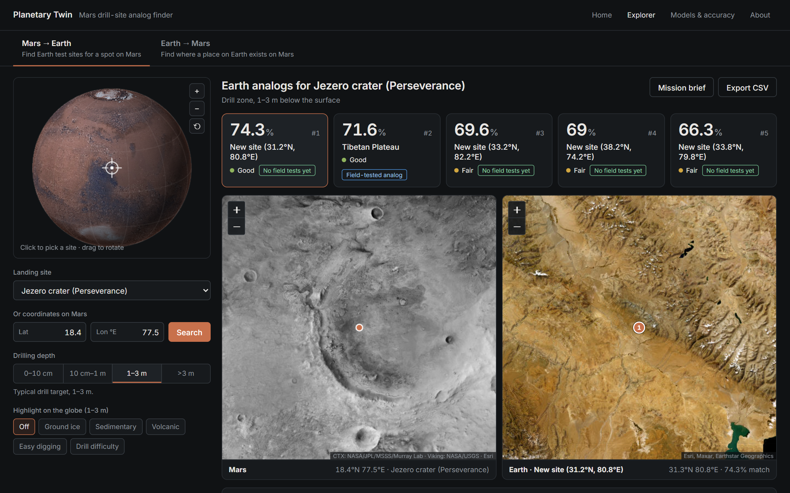
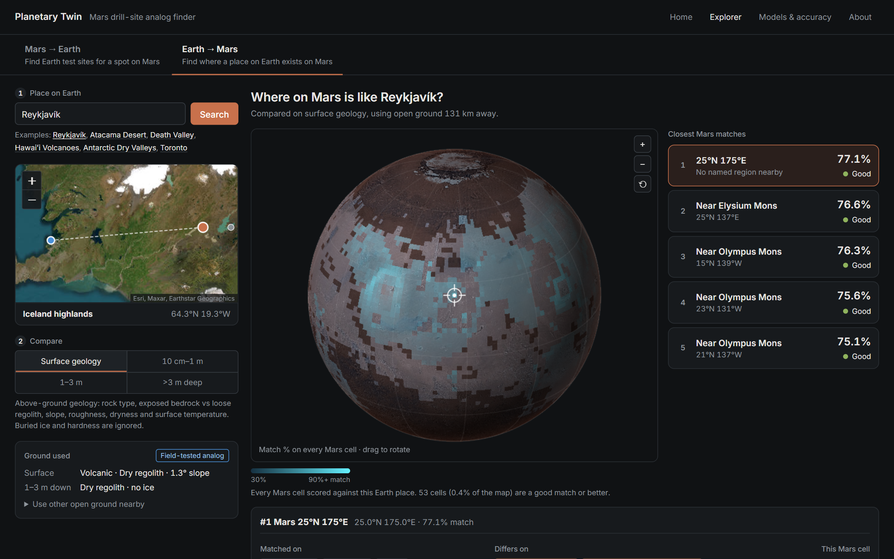
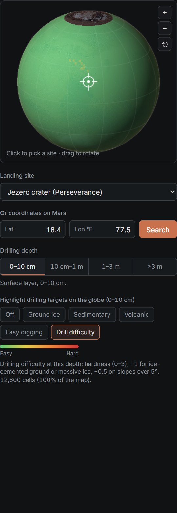
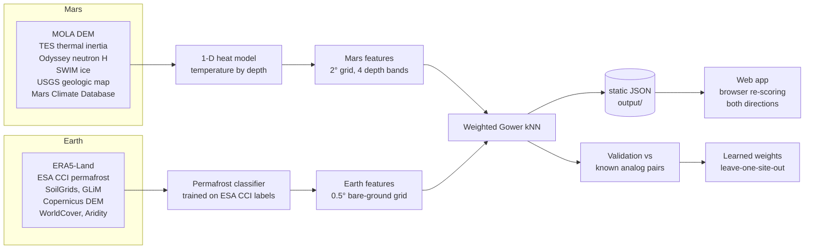
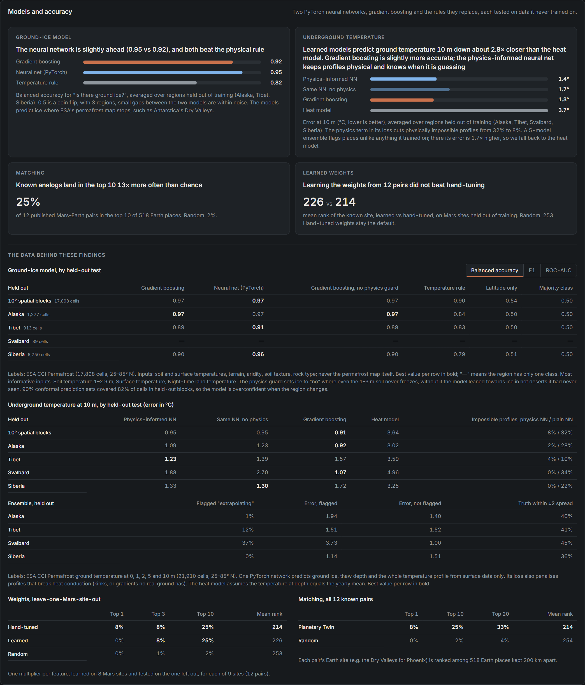

# Planetary Twin: Mars Drill-Site Analog Finder

**Find the place on Earth where the ground behaves like a chosen spot on Mars, and the reverse.**

[](https://dominic-chw.github.io/SpaceApps2026/web/)
[](https://github.com/dominic-chw/SpaceApps2026/actions/workflows/tests.yml)




Rovers and landers drill into Mars, but the hardware has to be tested on Earth first, at sites whose ground conditions resemble the target. Picking those sites today relies largely on experience and a handful of well-known locations. **Planetary Twin** turns that choice into a search problem. Click anywhere on Mars and choose a drilling depth. The app ranks every bare-ground cell on Earth by how closely its temperature, ground ice, ground type, hardness, rock, terrain and dryness match the Mars site, explains each match and links to past drill campaigns. It also proposes *untested* sites that nobody has used yet.

Built for the [NASA Space Apps Challenge 2026](https://www.spaceappschallenge.org/).

---

## Features

| | |
|---|---|
| **Mars → Earth** | Click the 3D Mars globe (or a landing site such as Jezero, Gale or Phoenix), pick one of four depth bands and get the top Earth analogs with match %, confidence, "matched on / differs on", satellite views of both planets and known drill campaigns. |
| **Earth → Mars** | The reverse search. Choose a place on Earth on the left (search, examples or a map click) and what to compare. All 12,600 Mars cells are scored in the browser, painted as a heat map on the globe, and the five closest are listed on the right (e.g. *Near Elysium Mons*). |
| **Surface-geology mode** | Reverse search can match **above-ground geology only** (rock type, exposed bedrock vs regolith, slope, roughness, dryness, surface temperature), or a specific depth underground. |
| **City and region search** | Type any city or region (OpenStreetMap geocoding with autocomplete). The app snaps to the nearest drill-testable open ground, shows how far away it is and lists nearby alternatives. |
| **Ground profile** | Side-by-side cross-section of Mars vs the Earth site through all four depth bands, with per-depth match %. |
| **Drill-difficulty heat map** | Globe overlay of how hard each Mars cell is to drill at the selected depth, plus overlays for ground ice, sedimentary or volcanic units and "easy digging". |
| **Mission brief** | One click produces a printable / PDF field-test brief: recommended site, both ground columns, all candidates, past campaigns and the model's validation accuracy. |
| **Hand-tuned / learned weights** | Switch between physics-based weights and weights learned from known analog pairs, or move the sliders. Everything re-ranks live in the browser with the same maths as the Python pipeline. |
| **Sites with no field tests yet** | Strong matches outside the known analog regions are flagged as candidate test sites that no NASA, ESA or university campaign has used. |
| **Models and accuracy** | In-app panel (header link "Models & accuracy") that leads with the findings and puts the full held-out tables underneath: ground ice (gradient boosting vs a PyTorch net vs the physical rule), underground temperature (physics-informed PyTorch ensemble vs gradient boosting vs the heat model), matching vs chance, learned vs hand-tuned weights. |
| **Underground temperature** | Each Earth twin shows its yearly-mean temperature from the surface to 10 m. The values come from ESA's map, from the neural-net ensemble, or from the heat model where the network would be extrapolating, and the source is always named. |
| **Shareable links** | Every view is in the URL (`#lat=18.4&lon=77.5&band=drill_zone`, `#mode=reverse&elat=64.15&elon=-21.94`). |

<p align="center">
  
</p>

<p align="center">
  
  
</p>

## How it works



1. **Same features on both planets.** For each depth band (`0–10 cm`, `10 cm–1 m`, `1–3 m`, `>3 m`): mean temperature, frozen share of the year, temperature swing, ground ice, ground type, hardness (0–3), rock class, slope, roughness and dryness.
2. **Physics where data is missing.** A 1-D heat-conduction model propagates daily and yearly surface temperature waves into the ground (skin depth `δ = √(κP/π)`, from thermal inertia). Mars is 60–100 K colder, so temperatures are compared as within-planet percentiles.
3. **ML where there is data.**
   - A permafrost classifier predicts Earth ground ice where ESA's satellite map stops (it only covers 25–85° N, but the Dry Valleys and the Andes are outside it).
   - Match weights are learned from the known analog pairs.
   - Both are tested on data they never saw (see below).
4. **Matching.** Weighted **Gower distance** handles mixed numeric and categorical features and skips missing values. Match % = `100·exp(−d / steepness)`, twins are kept ≥ 200 km apart, and each result lists the features that agreed and disagreed most.
5. **Same maths in the browser.** `web/rescore.js` re-implements the pipeline formula. The weight sliders, the ground profile and the whole Earth → Mars search run client-side, and the two directions give identical numbers for the same pair.

## Does it work?

Every number here is measured on data the model never trained on, next to a baseline. They are also shown in the app's **"How accurate is this?"** panel and in [`output/validation.json`](output/validation.json) and [`output/ml_report.json`](output/ml_report.json).

<p align="center"></p>

### Finding known analogs
This test uses **12 Mars–Earth analog pairs from the literature** (Phoenix ↔ Antarctic Dry Valleys, Gale ↔ Utah, Meridiani ↔ Rio Tinto, …). For each pair, the agreed Earth site is ranked among **518 distinct Earth places** (kept 200 km apart).

| | Planetary Twin | Random |
|---|---|---|
| Known analog in the top 10 | **25%** | 2% |
| Known analog in the top 20 | **33%** | 4% |
| Mean rank (of 518) | **214** | 254 |

### Ground-ice model (`pipeline/earth_ml/permafrost.py`)
- **Model:** gradient boosting, trained on **17,898 cells** labelled by ESA CCI Permafrost (ice if the permafrost fraction is ≥ 0.5, none if < 0.1, ambiguous cells dropped).
- **Inputs:** ERA5-Land soil and surface temperatures, MODIS land temperature, terrain, aridity, SoilGrids and GLiM rock class.
- **Leakage guard:** the permafrost layers are never inputs, and a test enforces this.
- **Test regions:** each region is held out entirely and predicted by a model trained without it.

| Balanced accuracy (held out) | Gradient boosting | Neural net (PyTorch) | Temperature rule | Latitude only |
|---|---|---|---|---|
| 10° spatial blocks | **0.97** | **0.97** | 0.90 | 0.54 |
| Alaska | **0.97** | **0.97** | 0.84 | 0.50 |
| Tibet | 0.89 | **0.91** | 0.83 | 0.50 |
| Siberia | 0.90 | **0.96** | 0.79 | 0.51 |

Findings:
- **Both models beat every baseline** on held-out regions.
- **The PyTorch MLP is no better than gradient boosting.** It is within about 0.01 on spatial-block F1 and ROC-AUC. It is ahead in Tibet and Siberia but behind on Svalbard F1 (0.93 vs 1.00).
- **Svalbard is all ice**, so only F1 can be computed there.
- **Hot deserts needed a physics guard.** The model never saw a hot desert (CCI's warmest permafrost-free cell is about 288 K) and leaned towards ice in Death Valley (p = 0.44). A guard now sets ice to "no" wherever even the 1–3 m soil never freezes. The unguarded model stays in the report for comparison.
- **Sanity checks outside CCI coverage:** Dry Valleys → ice (p = 1.0); Death Valley and the Atacama → no ice.
- **Uncertainty is overconfident under spatial shift.** The 90% conformal prediction sets covered only 82% of cells in held-out blocks.
- **The leak fix changed the honest score.** The old gap model reported 99% accuracy because it was fed the permafrost layer it was predicting. That input is now removed.

### Underground-temperature network (`pipeline/earth_ml/profile_nn.py`, PyTorch)
- **What it predicts:** ground ice, thaw depth and the yearly-mean ground temperature at 0, 1, 2, 5 and 10 m, from surface data only.
- **Architecture:** a multi-task MLP.
- **Physics-informed loss:** it penalises profiles that break heat conduction (kinks below 2 m, impossible gradients, ice above 0 °C).
- **Labels:** ESA CCI ground temperatures, 21,910 cells.

| Error at 10 m, °C (held-out regions, mean) | Physics-informed NN | Same NN, no physics | Gradient boosting | Heat model |
|---|---|---|---|---|
| Alaska, Tibet, Svalbard, Siberia | 1.38 | 1.65 | **1.32** | 3.71 |
| Physically impossible profiles (spatial CV) | **8%** | 32% | — | — |

- **Learned models vs the heat model:** both learned models are about 2.8× more accurate than the heat model.
- **Gradient boosting vs the neural net:** gradient boosting is slightly more accurate on average. The physics-informed net wins in Tibet and keeps profiles physical: 8% vs 32% impossible profiles for the same net without the physics term.
- **Production ensemble:** five networks with an out-of-distribution check (Mahalanobis distance in the hidden layer). Where it flags a place as unlike its training data, its error is 1.7× higher. There the app shows the heat model and says the network was not used.
- **Coverage:** 8,485 cells outside ESA's coverage use the network. Most of the tropics and the far south are flagged and use the heat model, which is the honest outcome for a model trained on cold northern ground.

### Learned match weights (`pipeline/validation/learn_weights.py`)
- **Model:** one multiplier per feature, bounded to 0.25–4 and pulled towards 1.
- **Training:** it minimises the mean log-rank of the known sites, using random search then Nelder–Mead.
- **Test:** leave-one-Mars-site-out (9 sites, 12 pairs), so each site is ranked by weights that never saw it.

| Held-out sites | Top 3 | Top 10 | Mean rank |
|---|---|---|---|
| Hand-tuned weights | 8% | 25% | **214** |
| Learned weights | 8% | 25% | 226 |
| Random | 1% | 2% | 253 |

**The learned weights did not beat the hand-tuned ones**, so the hand-tuned weights stay the default; the app offers the learned set as a toggle. With 12 pairs, one pair (Gusev ↔ Svalbard) swings the result, so the limit is labelled data, not the optimiser.

## Run it

**Easiest:** open the [live demo](https://dominic-chw.github.io/SpaceApps2026/web/).

**Locally:** everything the app needs is committed in `output/`, so there is nothing to download and no API key to set.

```bash
git clone https://github.com/dominic-chw/SpaceApps2026.git
cd SpaceApps2026
python -m http.server 8000        # Windows: py -m http.server 8000
```

Then open <http://localhost:8000/web/> for the home page, or <http://localhost:8000/web/app.html> to go straight to the explorer. An internet connection is needed for the map tiles, the Leaflet library and city search.

### Will the data work for everyone?

- **Web app: yes.** The ~55 MB of results in `output/` (one JSON per depth band plus the Earth library) are in the repo, so the app works out of the box for anyone, locally or on GitHub Pages.
- **Re-running the science pipeline: needs the raw data.** `data/` (~7 GB of Mars and Earth rasters) is not in git. `pipeline/data_fetch/` downloads the Mars layers. The Earth layers come from Google Earth Engine (free account) and NASA Earthdata (free login). Put credentials in `.env` (see `.env.example`), then:

```bash
conda env create -f environment.yml && conda activate analog-finder
python -m pipeline.earth_library.ee_export --fetch-grid --grid-deg 0.5 --min-bare 0   # Earth layers (~20 min)
python -m pipeline.earth_library.ee_export --fetch-antarctica
python -m pipeline.earth_library.ee_export --fetch-modis-lc
python -m pipeline.earth_library.build_layers     # Earth table + permafrost model -> output/ml_report.json
python -m pipeline.run_all --build --learn         # features, matching, learned weights, validation -> output/
pytest tests/                                      # runs on synthetic data, no download needed
```

The step-by-step version is in [`pipeline/README.md`](pipeline/README.md).

## Repository layout

```
web/                  static site: index.html (home), app.html + app.js (explorer), rescore.js (scoring in JS), about.html
output/               pipeline results the app reads (grid/<band>.json, earth_library.json, validation.json)
pipeline/
  data_fetch/         download + build Mars layers (MOLA, TES, neutron, MCD, geologic map)
  earth_library/      global Earth grid from Earth Engine exports, analog regions
  earth_ml/           permafrost classifier (CCI labels, baselines, conformal sets), optional PyTorch net, gap-filling
  physics/            1-D subsurface heat model
  mars_features/      per-band Mars feature extraction on a 2° grid
  matching/           normalisation, weighted Gower kNN, explanations
  validation/         known analog pairs, recall@K vs random baseline, ablation, learned weights (leave-one-site-out)
tests/                pytest suite (contract, coordinates, matching, validation, sources)
docs/plan.md          design doc and data contract
```

## Data sources

**Mars:** MGS MOLA 463 m DEM · MGS TES thermal inertia · Mars Odyssey GRS/neutron hydrogen · SWIM subsurface ice maps · USGS Geologic Map of Mars (SIM 3292) · Mars Climate Database v6.1 · CTX and Viking mosaics (imagery).
**Earth:** ERA5-Land · MODIS LST and land cover · ESA CCI Permafrost · Global Permafrost Zonation Index · Pelletier soil/regolith thickness · SoilGrids · GLiM lithology · Copernicus DEM · ESA WorldCover · Global Aridity Index · Esri World Imagery · OpenStreetMap Nominatim.
The full list with resolutions, licences and access methods is in [`research/datasets.csv`](research/datasets.csv).

## Limitations

- Mars is on a 2° grid (±70° latitude) and Earth on a 0.5° grid covering bare or sparsely vegetated ground only, the places where drill tests actually happen. Cities and forests snap to the nearest open ground.
- Subsurface values on both planets are partly modelled or predicted. The app shows confidence and data quality, and the deepest band is experimental.
- Match scores are research leads for choosing field-test sites, not drilling-safety certification.

## Team

Built for NASA Space Apps 2026 by **Markus Clarke**, **Waleed Diab**, **Dominic Chwieros**, **Archait Jain** and **Jad Wehbi**.

- Dominic Chwieros: Mars and Earth data acquisition, physics model, ML models (permafrost classifier, learned weights), shared pipeline, web features (home page, Earth → Mars search, city search, accuracy panel, mission brief, deployment)
- Jad Wehbi: Earth library, scoring and validation
- Archait Jain, Waleed Diab: web app

*Find your Mars location. Discover its Earth twin.*
